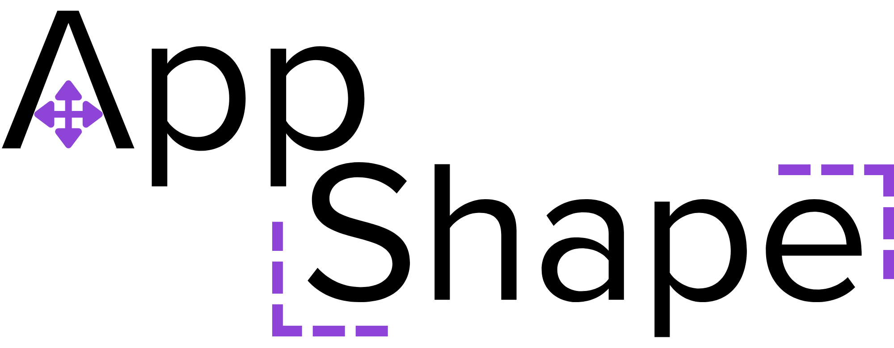

<p align="center">
  <picture>
    <source media="(prefers-color-scheme: dark)" srcset="brand/appshape-logo-white.png" />
    
  </picture>
</p>

<h3 align="center">Design your web and mobile apps, let your AI build them.</h3>

<p align="center">
  <a href="LICENSE"></a>
  
  
</p>

<p align="center">
  <a href="#how-it-works">How it works</a> ·
  <a href="#get-started">Get started</a> ·
  <a href="#using-appshape">Using AppShape</a> ·
  <a href="#coding-agents">Coding agents</a> ·
  <a href="#privacy">Privacy</a> ·
  <a href="#faq">FAQ</a> ·
  <a href="#architecture">Architecture</a> ·
  <a href="#contributing">Contributing</a>
</p>

---

AppShape is an open-source, local-first **design layer for apps that are built by AI**. Apps built
by AI ("vibecoded" apps) tend to look generic and inconsistent. AppShape puts a human back in charge
of the design:

1. **Design** whole apps on an infinite board: web pages and phone screens, layout, a design system,
   components, motion, and the flows between screens. Or **import** an existing React + Tailwind app
   and redesign its real pages.
2. **Apply to code.** Everything that can be written exactly goes straight into your code, with no
   AI and no API key. What needs judgment (logic, data, notes for the AI) goes to your coding agent
   (Claude Code, Codex, Cursor, …) as a precise changeset over MCP, the CLI or plain files.
3. **Check in the app.** AppShape opens the running app and compares it with the design, element by
   element, until the changeset is *verified*.

The person decides how the app looks, the AI proposes and implements, nothing changes without
review, and your code and designs stay on your computer.

> **Status:** early and moving fast (before 1.0). Designing, code generation, importing existing
> apps, verifying, the desktop app and the optional AI features all work and are covered by tests.
> The desktop installer is Windows-only for now. Native mobile apps are next (see
> [Roadmap](#roadmap)). Expect the design format to change before 1.0.

## How it works

```
  design from scratch ─┐     ┌───────────────────────────────────────────┐
                       ├───▶ │ Board: screens · layout · design system   │
  existing app ────────┘     │ components · flows · motion · notes       │
  (Import pages)             └─────────────────────┬─────────────────────┘
                                                   │ Apply to code
                          ┌────────────────────────┴───────────────────────┐
                          ▼                                                ▼
              Direct apply (no AI)                          Changeset for the agent
              new screens & components,                     logic, data, notes, code
              classes, texts, links, tokens                 changed by hand (MCP · CLI · files)
                          └────────────────────────┬───────────────────────┘
                                                   ▼
                                  Check in the app → verified | needs fix
```

- **Structured, not pixels.** Designs are a structured format (auto-layout, tokens, components,
  links), so they become real components and a real design system in code.
- **Two handoff modes from one format:** *build* (new apps and screens: full trees, tokens,
  components, navigation) and *change* (imported pages keep a baseline and source anchors, so the
  spec says exactly what changed and where it lives in the code).
- **Deterministic first, AI where it adds value.** Generated code and anchored literals are edited
  directly. Before each direct edit, AppShape checks that the code there still matches what it
  expects. If it doesn't, the change goes to the agent instead.
- **Plain files.** Every action is an operation; undo, persistence and changesets all use the same
  ops. Designs are stored as stable JSON in `.appshape/` (in your app's repository or a separate
  folder), so they diff cleanly in git.

### Supported stacks

| | Today | Planned |
|---|---|---|
| Frameworks | Vite + React Router, Vite + TanStack Router, Next.js App Router, Next.js Pages Router | Expo / React Native; later Vue, Svelte, Flutter, SwiftUI, Compose through adapters |
| Styling | Tailwind CSS v3 and v4 (CSS transitions by default, Motion code when the app already uses Motion) | NativeWind |
| Import | Running dev servers of React 19 apps, without installing anything in the app | Any URL without source; Figma |

## Get started

### Desktop app (Windows)

Download `AppShape-Setup-x.y.z.exe` from the [releases](../../releases) and run it. It needs no
admin rights. The installer isn't signed yet, so Windows may say "Unknown publisher": choose *More
info → Run anyway*. AppShape opens a start window:

- **Open my app** brings an existing app onto the board.
- **Start a new app** creates one from a template (stack, first page).
- Recent apps are one click away.

Boards open in your browser. Your app itself needs [Node.js](https://nodejs.org/en/download); the
start window checks that and everything else it needs, with download links. AppShape updates itself
from new releases. The switch at the bottom also puts the `appshape` command in your terminal.

### From source

Requires Node 22+ and pnpm 10 on your PATH (`corepack enable` once, or `npm i -g pnpm@10`).

```sh
git clone <this repository> appshape && cd appshape
pnpm install
pnpm appshape dev fixtures/vite-react-router-tw4   # the demo board in the browser
pnpm appshape init <path-to-your-app>              # a project for your own app
pnpm appshape init <app> --external <dir>          # …keeping design data outside the app repo
pnpm appshape start                                # the start page in the browser (open or create apps)
pnpm appshape doctor <path>                        # check a project's files
```

The first `appshape dev` builds the editor (`--rebuild` forces a rebuild after pulling changes).

## Using AppShape

### Designing

- **Screens and elements:** *New screen* in the sidebar (desktop, tablet, phone, or from a page
  template), then *Insert* in the bottom toolbar. Click an element to select it (click again to go
  deeper), double-click text to edit it, drag to reorder, and use the inspector on the right for
  layout, size, style, text, links and notes for the AI. ▷ next to a screen's name plays it as a
  clickable prototype.
- **Layout and placement:** auto layout (rows, stacks, grids, wrapping) with min/max sizes, aspect
  ratio, grid spans, order, overflow, z-index and *Pin* (sticky or fixed). Drop an element on the
  side of another to place them side by side. `M` or Ctrl+drag moves an element freely while keeping
  its place in the layout (*Put back* in the inspector). Things snap to the grid and to each other,
  with guides for edges, centers, equal spacing and equal size.
- **Theme starter:** makes the whole design system from a brand color, a gray tint, a font pair, a
  shape and a spacing density. It writes tokens (OKLCH color scales, semantic colors with dark-mode
  values, fonts, radius, spacing), with a live preview in light and dark. The font picker searches
  Google Fonts. Screens can have their own theme. With the board in dark mode (sun/moon in the top
  bar), the design panel edits the dark values.
- **Library:** page templates (landing, product, pricing, about, contact, blog post) and 25 sections
  (header, hero, features, pricing, FAQ, contact, footer, …), drawn in your theme. *Insert → Starter
  components* adds Button, Card, Badge, Input, Textarea, Select, Checkbox, Avatar, Accordion item
  and Nav link.
- **Components:** Ctrl+Alt+K turns a selection into a component. The main component appears on the
  board and every instance follows its edits. Instances change through properties (texts are
  exposed automatically), variants (*Add variant property*) and slots (*Make slot*).
- **Images, copy and paste:** upload, drop or paste images; use them as backgrounds too. Copy and
  paste elements between screens and projects (missing tokens come along), or copy and paste a
  style.
- **Text and visual styles:** rich text (bold, italic, underline, links, color for part of a text),
  named text styles (Display, H1–H4, Body, …) and effect styles (Card, Raised, Overlay, Glass).
  Changing H2 changes every H2, and in the code each style is one class. Gradients (also on text),
  several shadows, blur and backdrop blur, transforms with a rotate handle, per-corner radius,
  per-side borders, blend modes and opacity.
- **States, motion and interaction:**
  - *State* (Default, Hover, Focus, Pressed, Disabled) edits an element per state, and *Transition*
    sets how it animates between them.
  - Motion presets (fade, slide, scale, blur) play on load, on scroll into view or on hover, with
    stagger for lists and grids.
  - Interactions open overlays (modal, drawer, dropdown), switch variants or scroll to a section.
  - Accessible interactive components: mobile navigation, modal, drawer, dropdown, tabs, accordion
    and carousel.
  - Prototype transitions, and lists bound to sample data (generated as a data file plus `.map()`).
- **Responsive:** edit for a screen size and up. The inspector marks what differs per size, with
  *Reset to all sizes*, *Stack on phones*, *Show on* phone/tablet/desktop and *Show all sizes*.
- **Check design** (top bar, a count per screen): contrast in light and dark mode, values outside
  the design system, too many sizes, alt texts, heading order, tap targets and long lines, each with
  *Fix*, *Fix all* or *Ignore*.
- **Power users:** *Advanced → Classes* shows and takes raw Tailwind classes; what the inspector
  knows becomes settings, and the rest is kept and written into the code. Shift-click edits several
  elements at once (*Mixed* values), with *Align & distribute*. *Page settings* hold the title,
  description and share image. Ctrl+K opens the command palette, and `?` shows all shortcuts.

<details>
<summary><strong>Keyboard shortcuts</strong></summary>

`V` select · `H`/Space pan · `N` note · `A` arrow · `S` section · `T` text · Ctrl+Z / Ctrl+Shift+Z
undo/redo · Ctrl+C / Ctrl+X / Ctrl+V copy, cut, paste (also between screens and projects) ·
Ctrl+Alt+C / Ctrl+Alt+V copy and paste a style · Ctrl+D duplicate · Delete · Ctrl+G wrap in stack ·
Ctrl+Shift+G unwrap · Ctrl+Alt+K make component · Ctrl+Alt+B detach instance · Alt+↑/↓ move element ·
Esc select parent · Enter select child / edit text · `[` `]` z-order · Shift+1 fit · Shift+2
selection · Shift+0 100% · Ctrl+wheel zoom · arrow keys move (Shift: a grid step) · `M` or
Ctrl+drag: move freely · drag the handles of a selected element to resize it (corners keep
proportions; on a text, its size) · Alt: place without snapping · Shift: straight line / 15° rotation
steps · Ctrl+K command palette · F2 rename · `?` all shortcuts · right-click the empty board: add a
screen, note, text, section or arrow right there

</details>

### Existing app → board

*Import pages* (top bar) lists the app's pages and starts its dev server with its own package manager
(or uses a running one). It then captures the pages; nothing is installed in the app. Each page
becomes a screen that looks like the app (its own CSS and fonts) and knows the JSX behind every
element: AppShape reads React 19's debug information through the dev server's source maps. The
inspector shows that source, and it opens in VS Code. Elements from shared code (a header on every
page, list items) change together. For pages behind a login or states like an open dialog, use the
*capture browser* and its *Capture to AppShape* button. Emails, phone numbers, long numbers and keys
are replaced before anything is saved.

```sh
pnpm appshape import <app>        # all static pages (--route /x, --url http://localhost:3000)
```

### Design → code

*Apply to code* shows every change as a diff before writing anything. In an empty folder it creates
the app (pick the stack), installs it with pnpm and starts it, and *App ↗* opens it. Later applies
update the code and keep your own edits. On imported pages, classes, texts, links, images, icons,
deletes and new elements are written into the app's own files. Whatever needs judgment goes to your
coding agent as a changeset, with the exact place in the code: notes for the AI, code you changed by
hand, and phone screens.

```sh
pnpm appshape apply <app>         # the same from the terminal (--yes writes, --diff shows diffs)
```

### Check in the app

After *Apply to code*, *Check in the app* opens the changed screens in the running app, on desktop
and phone sizes. It compares every element with the design: box, text, colors, type, links, images,
icons and motion settings. Differences are listed and select the element on the board. Agent
changesets are checked the same way, and end up *verified* or *needs fix* with exact details for the
agent. Verified imported pages become the new code baseline.

```sh
pnpm appshape verify cs_… --app <app>   # exit code 0 = verified (--url to use a running dev server)
```

### Draw & describe (optional AI)

Mark up a screen the way you would a printout. **Draw** in the bottom toolbar gives you a pen,
arrows, shapes and labels, with a color legend: red removes, green adds, blue changes. Then describe
the change. Who designs it is up to you:

- **AppShape AI:** your own Anthropic API key (`ANTHROPIC_API_KEY`, or saved in the OS keychain by
  the desktop app), with a choice of Opus, Sonnet or Haiku and the expected cost shown first.
- **Your coding agent** over MCP: no key and no extra bill.
- **Just a note:** the drawing goes to the agent with the next handoff.

The result is a **proposal**: before/after, a list of changes in plain words, then *Accept* (one undo
step), *Try again* or *Discard*. Proposals are built from your tokens and components. The same flow
covers *a section from a sentence*, *make it work on phones* (larger sizes are checked to stay the
same), **3 variants** side by side, and *Review this page* (up to five findings, then you pick what
to fix). Everything else in AppShape works without AI.

### Settings and activity

The gear in the top bar opens the project settings: how your app is started (script, package
manager, port, or an app that is already running), privacy, code, checks, the board, AI agents
(connect Claude Code, Cursor, Codex or others in one click) and the matching terminal commands. The
CLI uses the same settings. What AppShape does (starting your app, capturing pages, writing code,
checks, your AI's progress) pops up at the top, and *Activity* shows all of it.

## Coding agents

AppShape is agent-agnostic: one compiled spec, three channels.

```sh
pnpm appshape init <app> --agent claude   # once: MCP config + instructions (claude, cursor, codex or generic)
pnpm appshape changesets <app>            # open tasks; spec <id> [--json], status <id> …
pnpm appshape requests <app>              # Draw & describe requests; request <id>, propose <id> <file.tsx>, review <id>
pnpm appshape mcp                         # the MCP server (stdio)
```

Then ask your agent: *"Implement the AppShape changeset cs_…"*.

| Channel | What it serves |
|---|---|
| **MCP** | `list_changesets`, `get_changeset`, `get_frame` (design as JSX or JSON), `get_tokens`, `list_components`, `get_component`, `set_changeset_status`, `set_change_status`, `verify_changeset`; for Draw & describe `list_design_requests`, `get_design_request`, `propose_design`, `submit_review`; prompts `implement_changeset` and `design_request` |
| **CLI** | The same, for any agent that can run shell commands |
| **Files** | `.appshape/specs/<id>.md` (+ `.json`), for agents without MCP or a shell |

**Tested with real agents.** Claude Code (Sonnet and Opus) closes the full loop (design → *Apply to
code* → agent over MCP → verify) in these scenarios:

- a new app with hand edits;
- an imported app with its own components;
- a Tailwind v3 Next.js app with a drawing kept as a note;
- Draw & describe through the agent.

Each run took 90–145 seconds, cost $0.17–0.79 in model usage and needed one verify round. The
harness is in [`packages/e2e/loop`](packages/e2e/loop) (`pnpm agent:loop`). Codex implemented the
hand-written specs in [`examples/m0-validation`](examples/m0-validation/README.md), but hasn't been
run through the full loop yet. Cursor hasn't been tested yet; reports are welcome.

## Privacy

AppShape has **no telemetry**: no usage statistics, crash reports, analytics or account. Your
project, your code and your designs stay on your computer. These are the only connections it makes:

| What | Where to | When | What is sent |
|---|---|---|---|
| Updates (desktop app) | This repository's GitHub releases | At start and every 6 hours, installed builds only | A version check, nothing about you or your projects |
| AppShape AI (Draw & describe) | The Claude API (`api.anthropic.com`), with your key | Only when you ask, after you've seen what is sent | Two pictures of the screen, the screen as JSX, your message and drawing, your tokens and components |
| Font catalog | `fonts.google.com` | When you open the font picker, at most weekly (cached in `~/.appshape/cache`) | Nothing but the request |
| Font files | `cdn.jsdelivr.net` (Fontsource) | When you preview or install a font | Nothing but the request for that font |
| Your app's dependencies | Your package manager's registry | Only when you ask AppShape to install them | What your package manager sends |

- **Capturing and verifying** run a local browser against your own dev server; every request to
  another origin is blocked, including your app's analytics, fonts and APIs.
- **Redaction** runs at capture time, before anything is written to `.appshape/` or reaches an
  agent. Emails, phone numbers, long numbers and keys are detected by default; add your own patterns
  or a `data-aps-redact` attribute.
- **Coding agents** talk to AppShape's MCP server on your computer (stdio). What the agent sends to
  its own provider is between you and that provider.
- **Your API key** is never written into the project and never sent to the board in the browser.

## FAQ

<details>
<summary><strong>Can't I just prompt Claude Code, Lovable or v0 to design the frontend?</strong></summary>

You can, and AppShape works alongside them. Prompting is good at producing *a* design quickly. It is
weak when you want *your* design:

- describing visual changes in chat is slow and imprecise;
- the agent often changes more than you asked;
- you can't see whether what was built matches what you meant.

AppShape gives you a visual board over your real code. Precise edits are written directly, without
AI. The agent gets an exact, scoped changeset for the rest, and *Check in the app* proves the result
matches. AI design (Draw & describe) is always a proposal you review. AI app builders also keep you
in their product; AppShape works on your own repository with any coding agent.

</details>

<details>
<summary><strong>Do I need an API key or a specific AI?</strong></summary>

No. Design, import, *Apply to code* and the checks work without AI. The handoff works with any agent
that speaks MCP or can run a shell command. A key is only needed for AppShape's own AI in Draw &
describe.

</details>

<details>
<summary><strong>Does AppShape change my app's setup?</strong></summary>

Import installs nothing in your app (no plugin, no dependency). Code generation adds what the
generated code needs (for example fonts, or Motion for a new app that uses it). Every write is shown
as a diff first.

</details>

<details>
<summary><strong>Mobile apps?</strong></summary>

You can design phone screens today, and the web code is responsive. Native apps (Expo / React
Native with NativeWind) are next on the roadmap.

</details>

<details>
<summary><strong>How is this different from Figma, Onlook or click-to-edit tools?</strong></summary>

Figma designs pictures that someone still has to build. Click-to-edit tools change one element on
one page through an AI prompt. AppShape is a whole-app board (screens, flows, a design system and
components), writes precise edits without AI, hands the rest to any coding agent, and checks the
running app against the design.

</details>

## Architecture

```
Project (.appshape/)
 ├─ project.json      how the app starts, viewports, settings, redaction rules
 ├─ tokens.json       the design system (from Tailwind v3/v4 or the theme starter)
 ├─ components/       components designed on the board
 ├─ board.json        the single board: screens' placements, notes, arrows, sections
 ├─ frames/<id>/      each screen: current.json (+ baseline.json for imported pages)
 ├─ changesets/       ops + status history (draft → ready → in_progress → applied → verified | needs_fix)
 ├─ requests/         Draw & describe requests and proposals
 ├─ specs/            compiled specs for agents (Markdown + JSON)
 ├─ assets/           images you added
 └─ .cache/           screenshots, render cache (git-ignored)
```

A screen is a tree of semantic nodes (`box`, `text`, `image`, `icon`, `button`, `input`, `list`,
`instance`, `slot`, …) with flexbox/grid layout, styles that refer to tokens, and per-size and
per-state overrides (`md:`, `hover:`). Imported nodes also carry a source anchor (file, line, column,
component). The format's source of truth is the zod schemas in [`packages/ir`](packages/ir/src);
what agents read is defined in [`packages/protocol`](packages/protocol/src). Both are MIT licensed
so other tools can produce and consume them.

Stack-specific code sits behind two interfaces in [`packages/adapter-sdk`](packages/adapter-sdk):
a **platform adapter** (detect the project, discover routes, capture, where new screens go) and a
**style dialect** (theme → tokens, classes ⇄ styles, minimal class diffs). New stacks are added as
adapters and dialects without changes to the core.

### Repository

| Path | What | License |
|---|---|---|
| [`packages/ir`](packages/ir) | Design format: schemas, ops, apply, diff, squash, changesets | MIT |
| [`packages/protocol`](packages/protocol) | Agent protocol: spec document, MCP contract, verify report, Markdown renderer | MIT |
| [`packages/adapter-sdk`](packages/adapter-sdk) | Interfaces for platform adapters and style dialects | MIT |
| [`packages/dialect-tailwind`](packages/dialect-tailwind) | Tailwind v3/v4 themes → design tokens, classes → design format | MIT |
| [`packages/kit`](packages/kit) | Design kit: theme generator (OKLCH scales, light and dark), starter components, sections, placeholder pictures | MIT |
| [`packages/store`](packages/store) | Reads and writes `.appshape/` folders (in-repo or external), file watching | AGPL-3.0 |
| [`packages/render`](packages/render) | Renders the design to React + CSS (container queries per screen) | AGPL-3.0 |
| [`packages/codegen`](packages/codegen) | Design → React + Tailwind for four stacks, direct apply (also to imported pages), agent handoff, JSX ↔ design | AGPL-3.0 |
| [`packages/capture`](packages/capture) | Import and verify: captures a running app with source anchors, its CSS and routes, redaction, capture browser, comparison | AGPL-3.0 |
| [`packages/ai`](packages/ai) | AppShape's own AI for Draw & describe (your API key) | AGPL-3.0 |
| [`packages/server`](packages/server) | Local server: project state, HTTP API, WebSocket | AGPL-3.0 |
| [`packages/editor`](packages/editor) | The board in the browser | AGPL-3.0 |
| [`packages/cli`](packages/cli) | The `appshape` command and MCP server; the bundle (`pnpm build`) | AGPL-3.0 |
| [`packages/desktop`](packages/desktop) | The desktop app (Electron): start window, installer, updates | AGPL-3.0 |
| [`packages/e2e`](packages/e2e) | End-to-end tests in an installed Edge/Chrome; the agent loop harness (`loop/`) | AGPL-3.0 |
| [`fixtures/vite-react-router-tw4`](fixtures/vite-react-router-tw4), [`vite-tanstack-router-tw3`](fixtures/vite-tanstack-router-tw3), [`next-app-router-tw4`](fixtures/next-app-router-tw4), [`next-pages-router-tw3`](fixtures/next-pages-router-tw3) | Test apps for importing (one per stack, Tailwind v4 and v3) | AGPL-3.0 |
| [`fixtures/generated-*`](fixtures) | Apps generated from the demo designs (per stack, landing page, motion) | AGPL-3.0 |
| [`examples/codegen-demo`](examples/codegen-demo) | The demo design, generated-app tests, live check | AGPL-3.0 |
| [`examples/m0-validation`](examples/m0-validation) | Hand-written changesets, agent specs and acceptance checks | AGPL-3.0 |
| [`examples/draw-eval`](examples/draw-eval) | Evaluation of AppShape's AI on drawn requests with real models | AGPL-3.0 |
| [`brand/`](brand), [`packaging/winget`](packaging/winget), [`scripts/`](scripts) | Logo and icon; winget manifest templates; the secret check | |

## Roadmap

- **Native mobile apps:** Expo / React Native import, the NativeWind dialect, phone screens rendered
  with react-native-web, and the native side of every design feature.
- **More of the loop:** the full agent loop with Codex and Cursor, and capturing native apps on a
  simulator or device.
- **More stacks:** adapters for Vue, Svelte, Flutter, SwiftUI and Compose; dialects beyond Tailwind.
- **More ways in:** import any URL without source, and Figma import.
- **Together:** multiplayer editing, and a plugin API for third-party adapters and dialects.
- **Distribution:** a signed installer, macOS and Linux builds, and winget.

## Development

```sh
pnpm typecheck
pnpm test
pnpm --filter @appshape/e2e e2e   # end-to-end tests (installed Edge; APPSHAPE_BROWSER=chrome for Chrome)
pnpm dev                           # work on the editor itself (Vite dev server + hot reload)
pnpm m0:check                      # acceptance checks for the agent specs
pnpm draw:eval                     # Draw & describe evaluation on real models (needs ANTHROPIC_API_KEY)
pnpm agent:loop                    # the full loop with Claude Code (LOOP_MODEL=opus, -g <scenario>)
pnpm check:public                  # secrets, private registries and .npmrc before you push
pnpm build                         # the CLI as one file + the board (packages/cli/dist)
pnpm desktop                       # build and run the desktop app
pnpm desktop:dist                  # its installer (packages/desktop/release)
```

Releases: push a tag `v1.2.3`. GitHub Actions builds the installer (with `SHA256SUMS.txt`) into a
draft release, and publishing that release ships it (installed apps update from published
releases). A nightly workflow checks the generated apps and fixtures against the newest React,
Next.js and Tailwind.

## Contributing

Issues, ideas and pull requests are welcome; see [CONTRIBUTING.md](CONTRIBUTING.md). Pull requests
need a one-time signature of the [Contributor License Agreement](CLA.md). Please report
security problems privately, as described in [SECURITY.md](SECURITY.md).

## License

AppShape is licensed under the [GNU AGPL-3.0](LICENSE). Packages meant to be installed into your
own projects (`ir`, `protocol`, `adapter-sdk`, `dialect-tailwind` and `kit`) are MIT licensed; see
the `LICENSE` file in each package.
